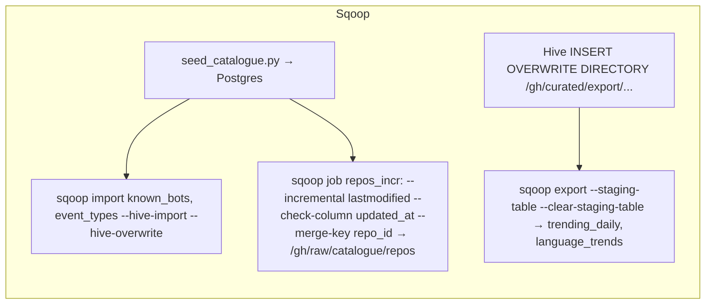
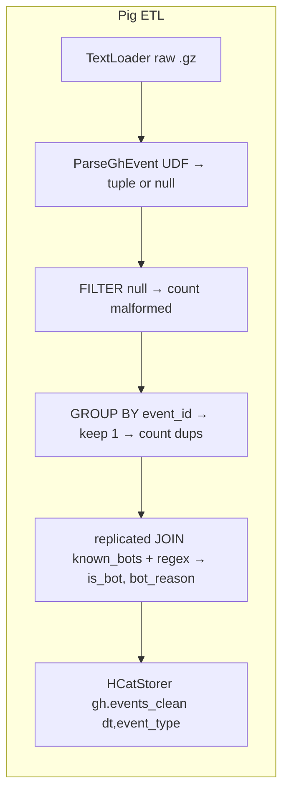
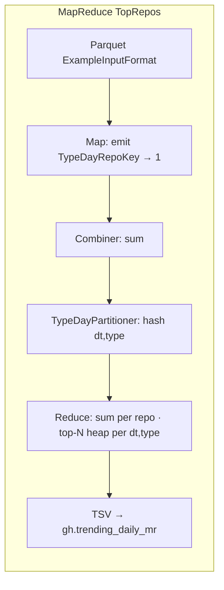
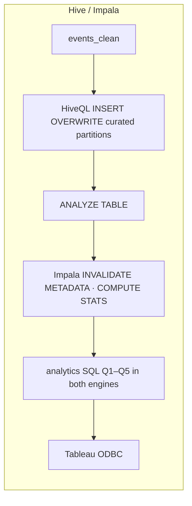
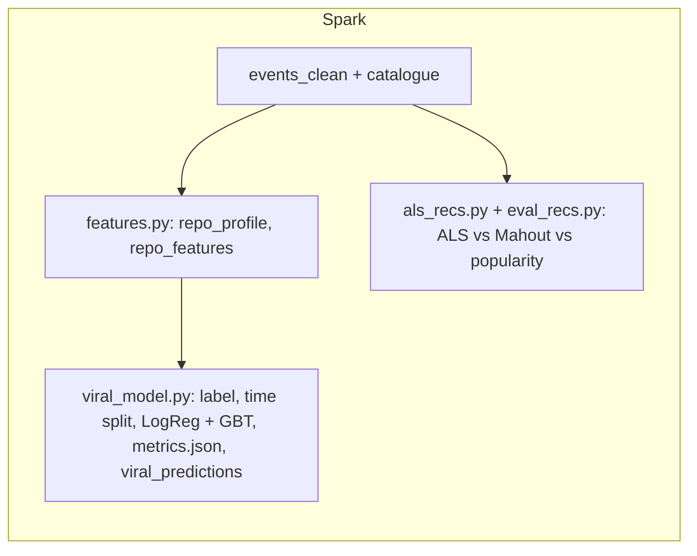
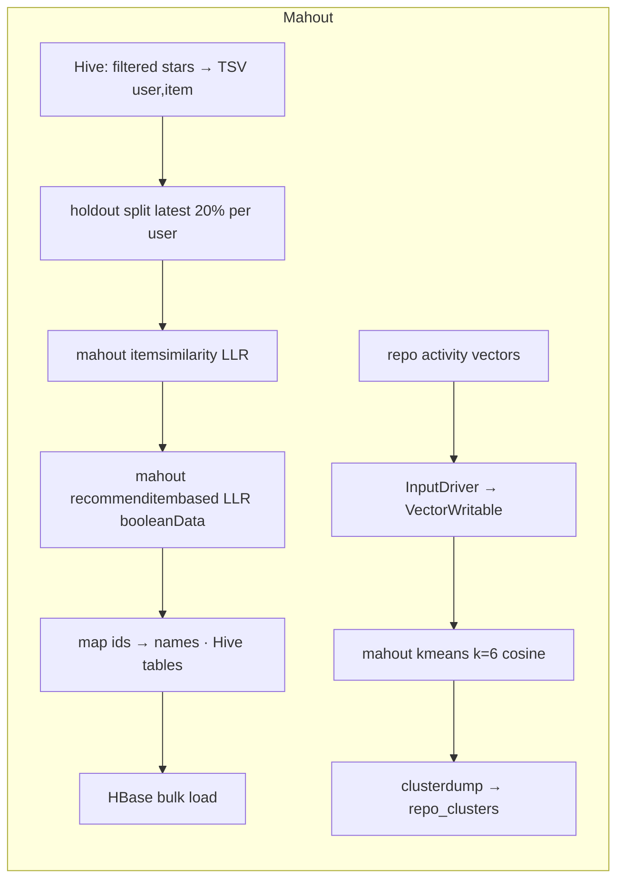
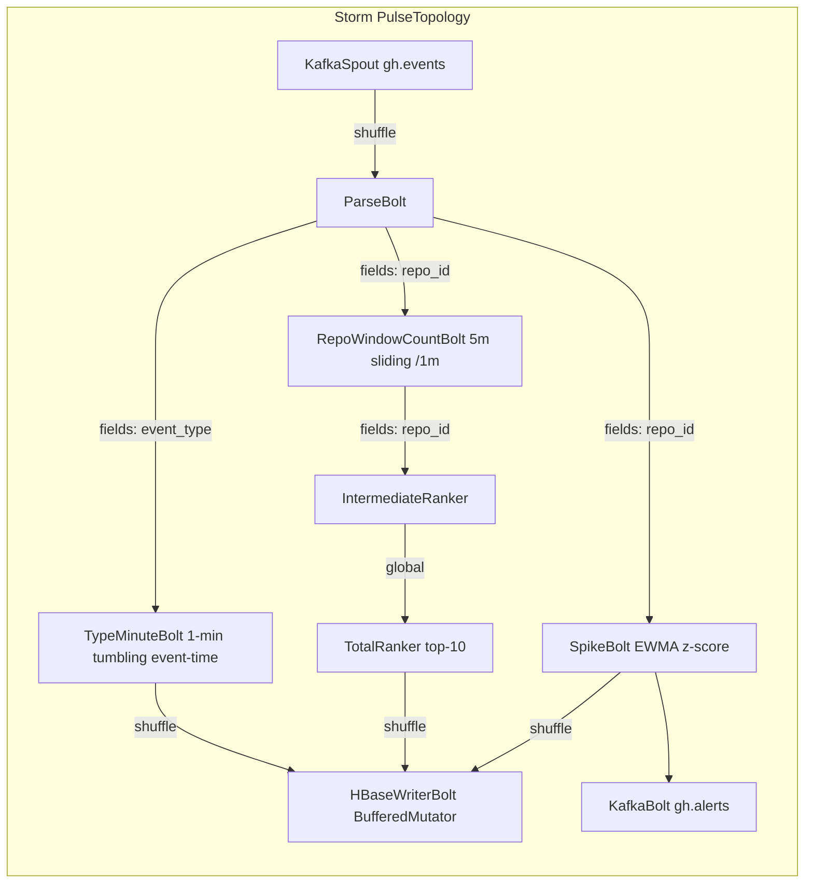
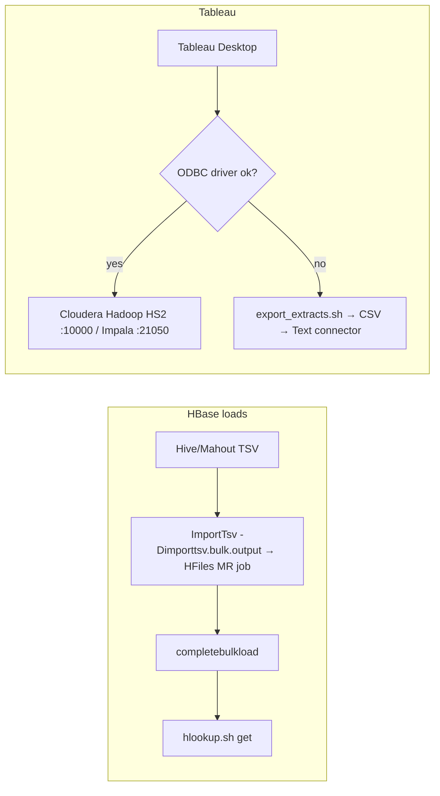

# GitHub Open Source Pulse: System Plan (PLAN.md)


## Context
This is a college Big Data Analytics mini-project. It analyses public GitHub activity from GH Archive (batch) and a replayed or live event stream (streaming). It must give each of ten tools real, explainable work: Spark, MapReduce, Hive, Impala, Mahout, Pig, HBase, Sqoop, Tableau and Storm. Everything runs on a Dockerised multi-node HDFS + YARN cluster, demoed live on a 16 GB laptop.

### Facts measured on 2026-10-12, before planning (they drive several decisions)
| Finding | Evidence | Consequence |
|---|---|---|
| **GitHub trimmed event payloads around Oct 2025** | `2025-09-10-15`: PullRequestEvent `pull_request` has 48 keys (`merged`, `merged_at`, `created_at`, `additions` …). `2026-10-05-12`: only `base, head, id, number, url`. PushEvent lost `commits`, `size` and `distinct_size`. | Use **September 2025** for batch (decision confirmed). Pig tags each row with a `payload_version` of `full` or `trimmed`. |
| Volume dropped sharply after the change | One hour in 2025-09 had 166,286 events and 5,110 WatchEvents. One hour in 2026-10 had 88,737 events and 267 WatchEvents. | Recent data is too sparse to give stars for recommendations or prediction. |
| File sizes (Sep 2025) | Hourly files are 80–105 MB gz, so a day is about 2.1 GB | sample = 3 h (≈0.27 GB) · demo = 2 days (≈4.2 GB, Sun 2025-09-07 + Mon 09-08 so weekend vs weekday exists) · large = 7 days (≈15 GB) |
| Hour in the URL is **not zero-padded** | `2026-10-05-3.json.gz` exists, `…-03…` returns 404 | The download script uses `${H}` without padding |
| Data quality of the sample | 0 malformed lines in 166k. 22.7% of events come from `*[bot]` logins. `org` is present on 29% of events. | Bot share is large enough to matter, so Pig still keeps malformed/duplicate filters |
| Dev Mac | arm64, **8 GB**, about 33 GB of free disk, Docker not running | The design targets the 16 GB laptop. A `lite` mode exists so development works on this Mac (sample data only). |
| `apache/impala` images | **amd64 only** (4.5.3, pushed 2026-10-06) | Impala runs under Rosetta on Apple Silicon. This is a key risk (§15). |
| `storm-hbase` connector | Last released as 2.5.0 | Write a custom HBase bolt using the HBase client |
| Kafka ZooKeeper mode | Removed in Kafka 4.0 | Pin Kafka 3.9 (cp-kafka 7.9.x) so ZooKeeper can be shared |
| Pig 0.18.0 | Released 15 Sep 2025 and supports Hadoop 3, Hive 3, HBase 2 and Spark 3 | No Pig-on-Hadoop-3 hacks are needed |

### Observed event fields (2025-09-10 15:00 UTC, 166,286 events)
- Top level: `id` (numeric string), `type`, `actor{id,login,display_login,gravatar_id,url,avatar_url}`, `repo{id,name,url}`, `org{…}` (optional), `payload`, `public`, `created_at` (`2025-09-10T15:00:00Z`)
- Event counts: Push 98,683 · Create 21,252 · PullRequest 12,739 · IssueComment 7,495 · PRReview 5,762 · Watch 5,110 · Delete 4,552 · PRReviewComment 3,736 · Issues 3,067 · Fork 1,373 · Release 1,003 · Member 632 · Public 604 · Gollum 168 · CommitComment 110
- Payload fields used:
  - Push: `ref, head, before, size, distinct_size, push_id`
  - Create/Delete: `ref, ref_type, master_branch, description`
  - PullRequest: `action, number, pull_request{merged, merged_at, created_at, closed_at, state, additions, deletions, changed_files, commits, user, author_association}`
  - Issues/IssueComment: `action, issue{number, state, created_at, closed_at, comments, user, pull_request?}`
  - PRReview: `review{state}`
  - Watch: `action=started` only, so **a star carries no extra data**
  - Fork: `forkee{id, full_name, language}`
  - Release: `release{tag_name, prerelease}`
  - Member: `member`
- Because a PR "closed" event carries both `created_at` and `merged_at`, open-to-merge time can be computed even when the PR was opened before the data window.

---

## 1. Analytical questions → tools
| # | Question | Primary tool(s) | Why this tool |
|---|---|---|---|
| Q1 | Most active / fastest-rising repos per day and week, by event type | **MapReduce** (daily top-N per type), **Hive** (week roll-up, day-over-day growth), Sqoop export | Top-N per group is the textbook MR key/value + partitioner design. Hive does windowed growth easily in SQL. |
| Q2 | Language and topic trends | **Sqoop** (catalogue) + **Hive** join, **Impala** interactive | Joins a relational dimension to fact data in the warehouse |
| Q3 | Activity by hour/weekday in UTC vs IST, weekend vs weekday | **Hive** (HiveQL `from_utc_timestamp`), **Impala** | Pure aggregation over partitioned Parquet |
| Q4 | Bot vs human share, and which types bots dominate | **Pig** (tags bots during ETL) → **Hive/Impala** | Tagging is row-level ETL logic, so it belongs in the Pig dataflow |
| Q5 | Maintenance health: PR open→merge time, issue close ratio, response activity | **Hive** (HiveQL over PR/issue fields) | Uses payload timestamps that exist in Sep 2025 data |
| Q6 | Fork/star ratio and contributor concentration (solo vs community) | **Spark** (feature engineering: top-contributor share, Gini) | Per-repo window aggregates are heavy and also feed ML |
| Q7 | "Starred X also starred Y" | **Mahout** item-based CF → **HBase** serving; **Spark ALS** for comparison | Implicit-feedback item CF is Mahout's classic use case |
| Q8 | Will a new repo go viral (cross T stars within N days)? | **Spark MLlib** (GBT vs LogReg) | Distributed feature building plus model training |
| Q9 | Live: events/min by type, bot split, top-K repos, spikes | **Kafka → Storm → HBase** | Low-latency windowed stream processing with a serving store |
| Q10 (added) | Repo activity clusters (e.g. "release-heavy", "PR factory", "star-only") | **Mahout k-means** (bonus) | Shows Mahout clustering in addition to CF |
| Q11 (added) | Per-repo hourly activity lookup in milliseconds | **HBase** (salted row keys) | Random reads by key, not scans |
| All | Dashboard | **Tableau** via Hive/Impala ODBC (CSV extracts as fallback) | Required BI layer |

Engine comparison: MR, Pig, Hive, Impala and Spark each run the same 3 benchmark queries (§10).

---

## 2. Architecture
```mermaid
flowchart LR
  subgraph Sources
    GHA[GH Archive<br/>hourly .json.gz]
    API[GitHub REST API<br/>/repos, /events]
  end
  subgraph Relational[Postgres 16]
    CAT[(catalogue DB<br/>repos, known_bots, event_types<br/>trending_daily, language_trends)]
    HMSDB[(metastore DB)]
    AFDB[(airflow DB)]
  end
  API -- seed_catalogue.py<br/>rate-limited, cached --> CAT
  GHA -- download_gharchive.sh<br/>curl stream to hdfs put --> RAW
  subgraph HDFS[HDFS rep=2 · YARN 2 NodeManagers]
    RAW[/raw zone<br/>gz JSON + Sqoop imports/]
    CLEAN[/clean zone<br/>Parquet dt/event_type/]
    CUR[/curated zone<br/>Parquet Hive tables/]
    ML[/ml zone/]
  end
  CAT -- Sqoop import<br/>full + incremental --> RAW
  RAW -- Pig ETL + Java UDF --> CLEAN
  CLEAN -- MapReduce top-N --> CUR
  CLEAN -- HiveQL --> CUR
  CLEAN -- Spark SQL / MLlib --> CUR
  CUR -- stars matrix --> MAH[Mahout itemCF / k-means<br/>MR on YARN] --> ML
  HMS{{Hive Metastore<br/>shared}} --- HIVE[HiveServer2] & IMP[Impala] & SPK[Spark]
  HIVE & IMP & SPK --- CUR
  CUR -- Sqoop export --> CAT
  ML & CUR -- ImportTsv bulk load --> HB[(HBase)]
  GHA -- replay_producer.py xN speed --> K[[Kafka gh.events]]
  API -. live_poller.py .-> K
  K --> ST[Storm PulseTopology] --> HB
  ST --> KA[[Kafka gh.alerts]]
  ZK((ZooKeeper)) --- K & HB & ST
  TAB[Tableau Desktop] -- ODBC --> HIVE & IMP
  HB -. Hive HBaseStorageHandler .-> HIVE
  AF[Airflow 3] -. docker exec edge pulse ... .-> RAW & CLEAN & CUR & HB
```

---

## 3. Cluster design

### 3.1 Images (only three are built by us, so disk and build time stay small)
| Image | Base | Contents | Used by |
|---|---|---|---|
| `bda/hadoop` | `eclipse-temurin:8-jdk-noble` (multi-arch) | Hadoop 3.3.6 (aarch64 or x64 tarball chosen by `TARGETARCH`), Python 3.12 | namenode, datanodes, RM, NMs, historyserver |
| `bda/stack` | `bda/hadoop` | + Hive 3.1.3, Pig 0.18.0, Sqoop 1.4.7, Mahout 0.13.0, Spark 3.5.9 (bin-hadoop3), HBase 2.5.x-hadoop3, Postgres JDBC, our jars and Python deps | hive-metastore, hiveserver2, hbase-master, hbase-regionserver, edge |
| `bda/airflow` | `apache/airflow:slim-3.3.x-python3.12` | + docker CLI | airflow |
| upstream | `postgres:16`, `zookeeper:3.8`, `confluentinc/cp-kafka:7.9.x`, `storm:2.8.9`, `apache/impala:4.5.3-{statestored,catalogd,impalad_coord_exec}` | | |

Downloaded tarballs are cached in `docker/cache/` and checked against Apache `.sha512` files, so rebuilds don't download again.

### 3.2 Containers (16 GB laptop: Docker Desktop memory = 11 GB, swap = 2 GB)
| Service | Role | Host ports | mem_limit (heap) | Profiles | Volumes / key config |
|---|---|---|---|---|---|
| postgres | catalogue + metastore + airflow DBs | 5432 | 384m | core | `pg-data`; `init.sql` creates the 3 DBs |
| namenode | HDFS NN | 9870, 8020 | 768m (512m) | core | `nn-data`; `dfs.replication=2`, `dfs.blocksize=64m` (so hourly files span 2 blocks for the fsck demo) |
| datanode1/2 | HDFS DN | 9864 / 9865 | 512m (256m) each | core | `dn1-data`, `dn2-data`; `dfs.client.use.datanode.hostname=true` |
| resourcemanager | YARN RM | 8088 | 640m (384m) | core | `yarn.scheduler.minimum-allocation-mb=256`, `maximum=1536` |
| nodemanager1/2 | YARN workers | 8042 / 8043 | 2g (256m) each | core | `yarn.nodemanager.resource.memory-mb=1536`, `vcores=2`, `vmem-check-enabled=false` |
| historyserver | MR JobHistory | 19888 | 448m (256m) | core | `mapreduce.jobhistory.*`, log aggregation on |
| hive-metastore | HMS (Thrift) | 9083 | 640m (512m) | warehouse, impala, ml | DB metastore on Postgres |
| hiveserver2 | HS2 for beeline/Tableau | 10000, 10002 | 1g (768m) | warehouse | `hive.execution.engine=mr` |
| edge | client box: pig, sqoop, hive CLI, mahout, spark-submit, hbase shell, python | — (4040 Spark UI) | 1.25g | batch, warehouse, ml, serving, streaming | repo mounted at `/opt/pulse`, `pulse` CLI |
| impala-statestored | Impala | 25010 | 256m | impala | amd64 (Rosetta on ARM) |
| impala-catalogd | Impala catalog (talks to shared HMS) | 25020 | 1g (JVM 768m) | impala | `--hms_event_polling_interval_s=0` (we run `INVALIDATE METADATA`/`REFRESH` instead) |
| impalad | coordinator + executor | 21050 (HS2/ODBC), 25000 | 2.5g | impala | `--mem_limit=1500m`, `--convert_legacy_hive_parquet_utc_timestamps=true` |
| zookeeper | shared by Kafka, HBase, Storm | 2181 | 384m (256m) | serving, streaming | `zk-data` |
| hbase-master | HMaster | 16010 | 640m (384m) | serving, streaming | `hbase.rootdir=hdfs://namenode:8020/hbase` |
| hbase-regionserver | RS | 16030 | 1.25g (896m) | serving, streaming | `hfile.block.cache.size=0.2`, handler.count=10 |
| kafka | broker (ZK mode) | 29092 (host), 9092 (internal) | 1g (512m) | streaming | `num.partitions=6`, `log.retention.hours=12`, RF=1 |
| storm-nimbus | Nimbus | 6627 | 640m (384m) | streaming | |
| storm-supervisor | 2 worker slots | 6700-6701 | 1.5g | streaming | `worker.childopts=-Xmx384m` |
| storm-ui | Storm UI | **8081** | 384m | streaming | |
| airflow | `airflow standalone` (LocalExecutor) | **8082** | 1.25g | orchestrate | `/var/run/docker.sock`, DB `airflow` on Postgres |

**Stage memory budgets.** `scripts/stage.sh <stage>` starts and stops the right set of services, so no stage goes over about 10.5 GB.
| Stage | Running | ≈ Limit sum |
|---|---|---|
| batch (Pig/MR/Sqoop/Mahout) | core + edge (+ zk/hbase for loads) | 7.4 + 1.25 = **8.7 GB** |
| warehouse (Hive) | core + HMS + HS2 + edge | **10.3 GB** |
| ml (Spark) | core + HMS + edge | **9.3 GB** |
| impala | postgres, NN, 2 DN, HMS, impala ×3, edge (**YARN stopped**) | **7.7 GB** |
| streaming | postgres, NN, 2 DN, zk, kafka, hbase ×2, storm ×3, edge (YARN stopped) | **9.1 GB** |
| orchestrate | batch stage + airflow | **10 GB** |
| lite (8 GB dev Mac, `LITE=1`) | 1 DN, 1 NM (NM 1.25g), `dfs.replication=1`, sample data only | ~5 GB |

**YARN / MR / Spark settings for 2 × 1536 MB of YARN memory**
- MR: `mapreduce.map.memory.mb=512 (-Xmx384m)`, `reduce=768 (-Xmx576m)`, `yarn.app.mapreduce.am.resource.mb=512`, `mapreduce.job.reduces=2`, `mapreduce.map.output.compress=true (Snappy)`
- Spark (client mode from edge): `executor.instances=2`, `executor.memory=640m`, `executor.memoryOverhead=384m`, `executor.cores=1`, `driver.memory=768m`, `spark.yarn.am.memory=384m`, `sql.shuffle.partitions=16`, dynamic allocation off, `spark.sql.hive.metastore.version=3.1.3`, `spark.sql.hive.metastore.jars=path` (pointing at `/opt/hive/lib/*`)
- Hive: `hive.exec.dynamic.partition.mode=nonstrict`, `hive.auto.convert.join=true`, `hive.exec.reducers.bytes.per.reducer=128m`, **`hive.strict.managed.tables=false`, `metastore.create.as.acid=false`, `hive.create.as.insert.only=false`** (otherwise Hive 3 makes managed tables ACID ORC, which Impala and Spark can't read), `hive.metastore.event.db.notification.api.auth=false`
- All containers use `TZ=UTC`

### 3.3 Version compatibility matrix
| Component | Version | Why it is compatible | Source |
|---|---|---|---|
| Java (Hadoop side) | Temurin 8 | Hive 3.1, Sqoop 1.4.7 and Mahout 0.13 all need Java 8 | hive.apache.org, attic.apache.org/projects/sqoop |
| Hadoop | **3.3.6** | Most widely tested with Hive 3.1.3. Ships an aarch64 build. | hadoop.apache.org/releases |
| Hive | **3.1.3** | Last 3.x. Sqoop `--hive-import` needs the `hive` CLI, which Hive 4 removed. Impala's HMS client is Hive-3 based. Workaround: replace `hive/lib/guava-19.jar` with Hadoop's `guava-27.0-jre.jar`. | archive.apache.org/dist/hive/hive-3.1.3 |
| Pig | **0.18.0** (non-`hadoop2` tarball) | Release notes: "works with Hadoop 3.X … Hive 3, HBase 2" | pig.apache.org/releases.html |
| Sqoop | **1.4.7** `bin__hadoop-2.6.0` (retired, Attic) | Runs on Hadoop 3 if `commons-lang-2.6.jar` is added to `sqoop/lib` (Hadoop 3.3 dropped it), plus the Postgres JDBC jar, `HIVE_HOME`, and `hive-common`/`hive-exec` on `HADOOP_CLASSPATH`. Known limit: `--incremental lastmodified` can't be combined with `--hive-import`, so incremental imports go to an HDFS dir with an external table over it. | archive.apache.org/dist/sqoop/1.4.7 |
| Spark | **3.5.9** (Scala 2.12) | Java 8/11/17. Talks to HMS 3.1.3 via metastore.version. Spark 4.x needs Java 17 and drops some Hive-3 paths. | spark.apache.org/downloads, docs "Interacting with Different Versions of Hive Metastore" |
| HBase | **2.5.x-hadoop3** (2.5.16) | Supports Hadoop 3.3.x and Java 8/11 | hbase.apache.org/book.html#hadoop |
| Mahout | **0.13.0** (MapReduce algorithms) | `recommenditembased`, `itemsimilarity` and `kmeans` run as MR jobs on YARN. **Samsara 14.1 needs Spark 2.4 / Scala 2.11, so it can't work with Spark 3.5. Rejected.** | archive.apache.org/dist/mahout/0.13.0, /14.1 |
| Impala | **4.5.3** Docker images | Reads Hive 3 HMS + HDFS Parquet. amd64 only. | hub.docker.com/r/apache/impala |
| ZooKeeper | **3.8.x** | Supported by HBase 2.5, Kafka 3.9 and Storm 2.8 clients | zookeeper.apache.org |
| Kafka | **3.9** (`cp-kafka:7.9.x`) | Last line with ZooKeeper mode (needed to share ZooKeeper) | kafka.apache.org/documentation (KIP-500 / 4.0 notes) |
| Storm | **2.8.9** (`storm:2.8.9`, JRE 17, multi-arch) | `storm-kafka-client:2.8.9` exists. `storm-hbase` stopped at 2.5.0, so we write a custom bolt with `hbase-client 2.5`. Storm 3.x is too new for course material. | hub.docker.com/_/storm, Maven Central |
| Postgres | 16 | Hive schematool `-dbType postgres`, Sqoop, Airflow | |
| Airflow | **3.3.x** (`apache/airflow` slim) | Maintained. Oozie is effectively unmaintained (last release 5.2.1 in 2021) and doesn't support Hadoop 3.3 cleanly. | airflow.apache.org |
| Tableau | Desktop (Students) + Cloudera ODBC for Hive 2.8.x / Impala 2.7.x (macOS universal) | Connectors: "Cloudera Hadoop" (HS2:10000) and "Impala" (21050) | tableau.com/support/drivers |

At implementation time, every patch version gets pinned in `.env`.

---

## 4. Data model

### 4.1 HDFS layout and formats
```
/gh/raw/events/dt=YYYY-MM-DD/YYYY-MM-DD-H.json.gz      gz JSON as downloaded (rep 2, 64 MB blocks)
/gh/raw/catalogue/{repos,known_bots,event_types}/      Sqoop text imports (tab-delimited; repos = incremental + merge-key)
/gh/clean/events/dt=…/event_type=…/*.parquet           Pig output, Snappy Parquet
/gh/curated/warehouse/gh.db/<table>/                   Hive/Spark curated tables, Parquet (hive.metastore.warehouse.dir)
/gh/curated/export/{trending_daily,language_trends}/   TSV staging for Sqoop export
/gh/ml/mahout/{input,similarity,recs,kmeans}/  /gh/ml/spark/{models,features}/
/gh/serving/hfiles/{hourly,recs}/                      HBase bulk-load staging
/gh/dq/stage_counts/                                   data-quality log (Hive table)
/hbase  /mr-history  /spark-logs  /tmp
```

### 4.2 Relational schema (Postgres DB `catalogue`)
```sql
CREATE TABLE repos (
  repo_id BIGINT PRIMARY KEY, full_name TEXT UNIQUE NOT NULL, owner_login TEXT,
  owner_type TEXT CHECK (owner_type IN ('User','Organization')),
  primary_language TEXT, topics TEXT,               -- comma-joined (arrays don't import with Sqoop)
  license_spdx TEXT, created_at TIMESTAMPTZ, stargazers_count INT, forks_count INT,
  open_issues_count INT, is_fork BOOLEAN, archived BOOLEAN, api_status SMALLINT, -- 200/404
  updated_at TIMESTAMPTZ NOT NULL DEFAULT now()     -- Sqoop --check-column (lastmodified)
);
CREATE TABLE known_bots (login TEXT PRIMARY KEY, source TEXT, added_at TIMESTAMPTZ DEFAULT now());
CREATE TABLE event_types (event_type TEXT PRIMARY KEY, category TEXT, description TEXT, key_payload_fields TEXT);
-- export targets (Sqoop export with --staging-table for idempotency)
CREATE TABLE trending_daily (dt DATE, event_type TEXT, rank INT, repo_id BIGINT, repo_name TEXT,
  events BIGINT, prev_day_events BIGINT, growth_pct NUMERIC(8,2), PRIMARY KEY (dt, event_type, rank));
CREATE TABLE language_trends (dt DATE, language TEXT, events BIGINT, stars BIGINT, active_repos INT,
  PRIMARY KEY (dt, language));
-- plus trending_daily_stage, language_trends_stage (same shape)
```

### 4.3 Hive DDLs (key tables; all live in DB `gh`)
```sql
-- RAW: external over gz JSON (JSON SerDe; unlisted fields are ignored)
CREATE EXTERNAL TABLE gh.events_raw (
  id STRING, type STRING,
  actor STRUCT<id:BIGINT,login:STRING>, repo STRUCT<id:BIGINT,name:STRING>, org STRUCT<id:BIGINT,login:STRING>,
  payload STRUCT<action:STRING, ref:STRING, ref_type:STRING, size:INT, distinct_size:INT,
    pull_request:STRUCT<number:INT,merged:BOOLEAN,created_at:STRING,closed_at:STRING,merged_at:STRING,
                        additions:INT,deletions:INT,changed_files:INT,`user`:STRUCT<login:STRING>>,
    issue:STRUCT<number:INT,state:STRING,created_at:STRING,closed_at:STRING,comments:INT,`user`:STRUCT<login:STRING>>,
    review:STRUCT<state:STRING>, release:STRUCT<tag_name:STRING>, forkee:STRUCT<id:BIGINT,full_name:STRING>>,
  public BOOLEAN, created_at STRING)
PARTITIONED BY (dt STRING)
ROW FORMAT SERDE 'org.apache.hive.hcatalog.data.JsonSerDe' STORED AS TEXTFILE
LOCATION '/gh/raw/events';

-- CLEAN: written by Pig through HCatStorer
CREATE EXTERNAL TABLE gh.events_clean (
  event_id BIGINT, created_at TIMESTAMP, created_ts BIGINT, actor_id BIGINT, actor_login STRING,
  is_bot BOOLEAN, bot_reason STRING, repo_id BIGINT, repo_name STRING, repo_owner STRING, org_login STRING,
  action STRING, ref_type STRING, push_size INT, push_distinct_size INT,
  pr_number INT, pr_merged BOOLEAN, pr_created_at TIMESTAMP, pr_closed_at TIMESTAMP, pr_merged_at TIMESTAMP,
  pr_additions INT, pr_deletions INT, pr_changed_files INT, pr_author STRING,
  issue_number INT, issue_created_at TIMESTAMP, issue_closed_at TIMESTAMP, issue_comments INT, issue_author STRING,
  review_state STRING, release_tag STRING, forkee_repo_id BIGINT, payload_version STRING)
PARTITIONED BY (dt STRING, event_type STRING) STORED AS PARQUET
LOCATION '/gh/clean/events' TBLPROPERTIES ('parquet.compression'='SNAPPY','external.table.purge'='true');

-- CURATED: managed, non-ACID Parquet (readable by Impala and Spark)
CREATE TABLE gh.repo_daily_activity (repo_id BIGINT, repo_name STRING, stars INT, forks INT, pushes INT,
  prs_opened INT, prs_merged INT, issues_opened INT, issues_closed INT, comments INT, releases INT,
  distinct_actors INT, bot_events INT, human_events INT)
PARTITIONED BY (dt STRING) CLUSTERED BY (repo_id) INTO 8 BUCKETS     -- bucket map join with catalogue
STORED AS PARQUET TBLPROPERTIES ('transactional'='false');
CREATE TABLE gh.stars (actor_id BIGINT, repo_id BIGINT, starred_at TIMESTAMP)
CLUSTERED BY (actor_id) INTO 8 BUCKETS STORED AS PARQUET TBLPROPERTIES ('transactional'='false');  -- Mahout input, per-user split
```
Other curated tables use the same pattern:
- `trending_daily`, `trending_weekly` (from the MR output plus Hive growth)
- `hourly_activity` (dt, hour_utc, hour_ist, weekday_utc, weekday_ist, is_weekend_ist, event_type, is_bot, events)
- `bot_share`
- `pr_lifecycle`, `issue_lifecycle`, `repo_health`
- `repo_profile` (Spark: fork_star_ratio, contributors, top1_share, gini)
- `repo_features`, `viral_predictions` (Spark)
- `language_trends`, `topic_trends` (join with `catalogue_repos`)
- `similar_repos`, `user_recs` (Mahout output, mapped to names)
- `repo_clusters`
- `dq_stage_counts`
- Catalogue external tables: `catalogue_repos`, `known_bots`, `event_types` (`known_bots` and `event_types` come from Sqoop `--hive-import`)
- `live_minute_hbase`: Hive external table **over HBase** (`HBaseStorageHandler`) for the live Tableau view

### 4.4 HBase tables (pre-split, `COMPRESSION=>'SNAPPY'`, 1 version)
| Table | Row key | Families / qualifiers | Written by |
|---|---|---|---|
| `repo_hourly` | `salt(2 hex)` + `\|` + `repo_id(0-padded 12)` + `\|` + `yyyyMMddHH` | `c:` one qualifier per event type → count, plus `c:bot` | Hive hourly agg → ImportTsv bulk load (HFiles) |
| `repo_similar` | `salt` + `\|` + `repo_id` | `s:01..s:20` → `repo_id\|full_name\|score`, `m:name` | Mahout itemsimilarity → bulk load |
| `user_recs` | `salt` + `\|` + `actor_login` | `r:01..r:10` → `repo\|score` | Mahout recommenditembased → bulk load |
| `live_minute` | `bucket(minute % 8)` + `\|` + `yyyyMMddHHmm` | `t:<EventType>`, `b:bot`, `b:human` (atomic `Increment`) | Storm |
| `live_topk` | `yyyyMMddHHmm` (window end) | `k:01..k:10` → `repo\|count` | Storm |
| `spike_alerts` | `(Long.MAX − epochMinute)` + `\|` + `repo_id` | `a:count`, `a:mean`, `a:z`, `a:name` | Storm |

Salting:
- `salt = first 2 hex chars of MD5(repo_id)`, which gives 256 possible prefixes. The table is pre-split into 16 regions on the first hex digit.
- Raw repo IDs are roughly sequential (newer repos have bigger IDs), and time suffixes are monotonic. Without a hash prefix, every bulk-load and new-repo write would land on the last region and hotspot one RegionServer.
- The salt is a deterministic function of the key, so a reader recomputes it. A single `Get`/`Scan` per repo still works, unlike random salting.
- A single **very popular repo** writes to rows that differ per hour, and Storm **pre-aggregates per window**, so a hot repo costs one `Increment` per minute instead of one per event.
- For `live_minute`, the time-ordered key gets a `minute % 8` bucket prefix so consecutive minutes land in different regions. Dashboard reads issue 8 small scans.
- `scripts/hlookup.sh repo facebook/react` computes the salt for the HBase-shell demo.

### 4.5 Kafka topics
| Topic | Partitions | Key | Value | Retention |
|---|---|---|---|---|
| `gh.events` | 6 | `repo_id` (per-repo ordering → fields grouping matches) | slim JSON `{id,type,created_at,actor_id,actor_login,repo_id,repo_name,org,action,source:"replay"\|"live"}` | 12 h |
| `gh.alerts` | 1 | `repo_id` | spike alert JSON | 24 h |

---

## 5. Flow diagrams
```mermaid
flowchart LR
  subgraph F1[Download & load]
    a1[mode: sample/demo/large<br/>or --start --end] --> a2[for each day, hour<br/>skip if HDFS file exists] --> a3[curl -f --retry 5 URL | hdfs dfs -put - tmp] --> a4[gzip -t check · mv into dt= partition] --> a5[DQ: lines per file → dq_stage_counts] --> a6[MSCK REPAIR gh.events_raw]
  end
```









---

## 6. Detailed designs

### 6.1 MapReduce: `TopReposByTypeDay` (Java, Hadoop 3.3.6 mapreduce API)
- **Input**: `gh.events_clean` Parquet via `parquet-hadoop` `ExampleInputFormat`, reading only `dt, event_type, repo_id, repo_name, is_bot`. The `-Dpulse.excludeBots=true` option drops bot events.
- **Key**: `TypeDayRepoKey implements WritableComparable` holding `(Text dt, Text eventType, LongWritable repoId)`. It sorts by dt, then type, then repoId, so all counts for one (dt, type) arrive at a reducer together and in order.
- **Value**: `LongWritable` count. The repo name is looked up in the reducer from a distributed-cache file (`repo_id → name`, built from the same input by a tiny Hive query) to keep the shuffle small.
- **Combiner**: `LongSumCombiner`. It is legal because sum is associative and commutative. Measured on the sample: 339,820 → 209,245 shuffle records (−38%). The cut grows with data size, because each mapper then sees more events per repo.
- **Partitioner**: `TypeDayPartitioner` uses `(hash(dt + eventType) & MAX) % numReducers`. It ignores repoId on purpose, so **one reducer sees every repo for that (dt, type) and can compute an exact top-N**. The default HashPartitioner would scatter repos and require a second job. Downside: skew, because PushEvent is about 60% of events. This is explained in the viva and shown in JobHistory reducer times.
- **Reducer**: sums values for each key. When (dt, type) changes it flushes a min-heap of size N (default 25), outputting `dt \t type \t rank \t repo_id \t name \t count`.
- **Custom counters**: `Pulse.RECORDS_IN`, `BOT_SKIPPED`, `GROUPS`, `NULL_REPO`. These show up in JobHistory.
```
map(_, rec):  if excludeBots && rec.is_bot: ctr.BOT_SKIPPED++; return
              emit(TypeDayRepoKey(rec.dt, rec.event_type, rec.repo_id), 1)
combine(k, vs): emit(k, sum(vs))
partition(k): (hash(k.dt+k.type) & MAX) % R
reduce(k, vs):  if (k.dt,k.type) != cur: flush(heap); cur=(k.dt,k.type)
                heap.offer((sum(vs), k.repoId)); if heap.size>N: heap.poll()
cleanup: flush(heap)
```
- The bench variants (§10) live in the same jar: `CountByTypeDay` (Q1), `TopReposByTypeDay` restricted to WatchEvent (Q2), and `EventsByLanguage` (Q3, a map-side join that loads the catalogue TSV from the distributed cache in `setup()`).

### 6.2 Pig ETL outline (`pig/etl_events.pig`, run with `pig -useHCatalog -param dt=…`)
**JSON parsing decision: a Java UDF `ParseGhEvent` (Jackson).** The built-in `JsonLoader` needs one fixed schema for the whole record and fails or returns nulls when a nested `payload` changes shape by event type or a key is missing. elephant-bird (map-based loading) is unmaintained and stuck on Hadoop 2. A UDF tolerates missing or trimmed fields, returns `null` for malformed lines (counted, never fatal), sets `payload_version`, and is unit-testable in JUnit against real fixtures. It lives in the same Maven module as the MR job.
```pig
REGISTER /opt/pulse/java/hadoop-jobs/target/pulse-hadoop.jar;
DEFINE Parse pulse.pig.ParseGhEvent();
raw    = LOAD '/gh/raw/events/dt=$dt' USING TextLoader() AS (line:chararray);   -- .gz handled natively
parsed = FOREACH raw GENERATE FLATTEN(Parse(line)) AS (event_id, event_type, created_at, …);
good   = FILTER parsed BY event_id IS NOT NULL AND event_type IS NOT NULL AND created_at IS NOT NULL;
grp    = GROUP good BY event_id;
dedup  = FOREACH grp { one = LIMIT good 1; GENERATE FLATTEN(one); };
bots   = LOAD 'gh.known_bots' USING org.apache.hive.hcatalog.pig.HCatLoader();
j      = JOIN dedup BY actor_login LEFT OUTER, bots BY login USING 'replicated';
tagged = FOREACH j GENERATE …, (actor_login MATCHES '.*\\[bot\\]$' ? 'suffix' :
           (bots::login IS NOT NULL ? 'list' : (actor_login MATCHES '(?i).*[-_]bot$' ? 'name' : null))) AS bot_reason, …;
out    = FOREACH tagged GENERATE …, (bot_reason IS NOT NULL) AS is_bot, '$dt' AS dt, event_type;
STORE out INTO 'gh.events_clean' USING org.apache.hive.hcatalog.pig.HCatStorer();   -- dynamic partition on event_type
-- DQ: counts of raw, good, dedup, bots stored to /gh/dq/pig/$dt
```
- Idempotency: `pulse pig-etl` first drops the `dt` partitions.
- Fallback if HCatStorer misbehaves: `MultiStorage` on event_type to TSV, then a Hive `INSERT OVERWRITE … SELECT` into Parquet.

### 6.3 Storm topology `PulseTopology` (Java, Storm 2.8.9)
| Component | Parallelism | Grouping in | Logic |
|---|---|---|---|
| `KafkaSpout` (storm-kafka-client) | 2 | — | topic `gh.events`, at-least-once, `UNCOMMITTED_EARLIEST` |
| `ParseBolt` | 2 | shuffle | JSON → `(ts, event_type, repo_id, repo_name, actor_login, is_bot)`. Bot list loaded at `prepare()` from Postgres `known_bots` plus the `[bot]` regex. |
| `TypeMinuteBolt` (BaseWindowedBolt) | 1 | fields(event_type) | **event-time** tumbling 1 min (`withTimestampField("ts")`, lag 10 s). Counts per type and bot/human. |
| `RepoWindowCountBolt` | 2 | fields(repo_id) | sliding window 5 min, advancing every 1 min, event-time. Counts per repo. |
| `IntermediateRanker` | 2 | fields(repo_id) | partial top-20 |
| `TotalRanker` | 1 | global | final top-10 per window |
| `SpikeBolt` | 2 | fields(repo_id) | Per-repo per-minute count c with EWMA μ and σ² (α=0.2). Alert if `c ≥ max(15, μ + 4σ)` after 10 warm-up minutes. LRU cap of 200k repos. |
| `HBaseWriterBolt` | 1 | shuffle | `BufferedMutator`, `Increment` for counters, `Put` for top-K and alerts. Flush every 1 s or 500 ops. Acks after flush. |
| `KafkaBolt` | 1 | shuffle | alerts → `gh.alerts` |

Event-time windows mean that at a 60× replay, "one GitHub minute" still forms one window, so the counts stay meaningful. Delivery is at-least-once, so replays after a failure can double-increment. This is documented as an accepted trade-off.

**Replay producer** (`streaming/replay_producer.py`, `confluent-kafka`)
- Reads hourly gz files from HDFS (WebHDFS) or the local cache and sorts each hour by `created_at`.
- Sleeps `Δt / SPEED` between events (`--speed 60` replays 1 h in 1 min). `--loop` repeats.
- Live poller: `GET /events` with `If-None-Match` (ETag) and honours `X-Poll-Interval` and `X-RateLimit-*`.
  - Up to 3 pages every 60 s, which is about 180 calls/h, well under the 5,000/h token limit.
  - It dedups ids and sets `source=live`.
  - The live payload is trimmed, but Storm only needs top-level fields.

---

## 7. ML design

### 7.1 Mahout item-based CF
- **Matrix**: rows `actor_id`, columns `repo_id` (both native longs; Mahout needs numeric ids), boolean preference = "starred" (WatchEvent `started`).
- **Filtering** (Hive):
  - Drop bot actors.
  - Keep users with 3–300 stars in the window (fewer than 3 gives no co-occurrence signal; more than 300 looks like star-farming or automation).
  - Keep repos with at least 5 distinct stargazers.
  - Expected scale for 7 days: about 700k stars, which leaves about 150–250k after filtering.
- **Similarity**: `SIMILARITY_LOGLIKELIHOOD`. Dunning's LLR is robust for sparse implicit counts and doesn't over-reward rare co-occurrences the way Jaccard or cosine do.
- **Commands**:
  - `mahout itemsimilarity --booleanData true -s SIMILARITY_LOGLIKELIHOOD --maxSimilaritiesPerItem 20`
  - `mahout recommenditembased --booleanData true -s SIMILARITY_LOGLIKELIHOOD --numRecommendations 10 --maxPrefsPerUser 300`
  - Both run as MR on YARN.
- **Evaluation**:
  - For every user with at least 5 stars, hold out the **latest 20%** of their stars by time.
  - Train on the rest and compute Precision@10, Recall@10, HitRate@10 and catalogue coverage (Spark `eval_recs.py`).
  - Baselines: global popularity, and Spark ALS (`implicitPrefs=true`, rank 32) on the same split.
  - Results go into one comparison table for the report.
- **Bonus k-means**:
  - Per repo, a 10-dimensional activity vector: log1p shares of stars, forks, pushes, PRs, issues, comments and releases, plus bot share, distinct actors and active hours.
  - Run `InputDriver` → `mahout kmeans -k 6 -dm CosineDistanceMeasure -x 20 -cl`, then `clusterdump`.
  - Label the clusters by hand.

### 7.2 Spark MLlib viral-repo prediction
- **Population**: repos with a `CreateEvent ref_type='repository'` on day 1 or 2 of the large window (2025-09-01/02). Repo creation time is t0.
- **Features** (window t0 → t0+24h, from `events_clean`):
  - stars_24h, forks_24h, distinct_stargazers_24h, star_velocity_last6h, max_stars_in_hour
  - pushes, PRs, issues, releases_24h, distinct_actors_24h, bot_share
  - is_org (from `org`), creation hour/weekday (UTC), has_description (CreateEvent `description`), name length
  - Optional: language from ForkEvent `forkee.language` or the catalogue when present
- **Label**: `stars(t0+24h, t0+24h+N·24h] ≥ T`, with **N = 5 days** and T chosen from the data so roughly 2–3% are positive (expected T ≈ 20–30). The final N and T are confirmed after the EDA notebook query.
- **Split by time, no leakage**:
  - Train on repos created 09-01, test on repos created 09-02.
  - Features only ever use the first 24 h.
  - Labels need data through 09-08, so the large mode downloads **8 days**. Demo mode runs the pipeline with N=1 and marks it "illustrative only".
- **Models**: `LogisticRegression` (baseline, standardised features) and `GBTClassifier` (depth 4, 50 iterations), with `CrossValidator` (3 folds) on train only. Class imbalance is handled with a `weightCol`.
- **Metrics**: AUC-PR (primary, because the classes are imbalanced), AUC-ROC, precision@50 and recall at the chosen threshold, plus GBT feature importances. Saved to `/gh/ml/spark/metrics.json` and the Hive table `model_metrics`.
- **Output**: `viral_predictions(repo_id, repo_name, prob, label, created_at)` for the Tableau "Viral watchlist".

---

## 8. Orchestration (Airflow 3, two DAGs)
Every task is `BashOperator: docker exec bda-edge pulse <cmd> …`. The **same `pulse` CLI** is what `make` and the viva use, so there is no duplicated logic. Settings:
- Pool `yarn` (1 slot) serialises the YARN-heavy tasks.
- Default retries: 2 with exponential backoff (1 → 4 min). Downloads get 5 retries.
- Every task is idempotent: it overwrites its partition or table, and Sqoop export uses a staging table.

**DAG `gh_pulse_daily`**
- `schedule="@daily"`, `start_date=2025-09-01`, `end_date` set by mode, `catchup=True`, `max_active_runs=1`. Each run processes one day.
- Task chain:
  ```
  download_load(dt) → dq_raw(dt) → sqoop_import_lookups → pig_etl(dt) → dq_clean(dt)
     → [mr_top_repos(dt), hive_curated(dt)] → dq_curated(dt)
  ```

**DAG `gh_pulse_models`** (manual trigger, or `TriggerDagRunOperator` after the last daily run)
```
seed_catalogue (API, cached) → sqoop_import_repos_incremental → hive_catalogue_joins (language/topic trends, weekly trending)
  → spark_features → [spark_viral, mahout_itemcf → spark_eval_recs(+ALS), mahout_kmeans]
  → [hbase_load_hourly, hbase_load_recs] → sqoop_export → dq_report
```
- The catalogue is seeded **after** curation because the "top N most active repos" come from our own data. Each new date range adds repos, which is what makes the **incremental** import meaningful.
- Airflow runs only in the `orchestrate` stage. `make pipeline MODE=sample` runs the same commands without Airflow if RAM is tight.

---

## 9. Tableau dashboard (8 views)
| View | Source (Hive/Impala table) | Chart |
|---|---|---|
| 1. Trending now | `trending_daily` (+ MR output) | Ranked bars. Filters: day, event type. |
| 2. Rising repos | `trending_weekly` (growth_pct) | Slope chart day 1 → day 7 |
| 3. Languages & topics | `language_trends`, `topic_trends` | Line chart over days, topic treemap |
| 4. Activity clock | `hourly_activity` | Hour × weekday heatmap with a UTC/IST parameter swap, plus a weekend vs weekday bar |
| 5. Bots vs humans | `bot_share` | 100% stacked bar by event type, top bot accounts |
| 6. Maintenance health | `repo_health`, `pr_lifecycle` | Box plot of hours-to-merge, scatter of issue close ratio vs PR volume |
| 7. Solo vs community | `repo_profile` (+ `repo_clusters`) | Scatter: top-contributor share vs fork/star ratio, colour = k-means cluster |
| 8. Recommendations & viral watchlist | `similar_repos`, `user_recs`, `viral_predictions` | Type-in parameter → similar-repos table, plus a table of top predicted-viral new repos |
| (opt) Live pulse | `live_minute_hbase` (Hive over HBase) or `live_minute.csv` | Events/min line, auto-refresh |

Connection steps (documented in `tableau/README.md`):
1. Install "Cloudera ODBC Driver for Apache Hive" and "… for Impala" from tableau.com/support/drivers (macOS universal pkg).
2. Hive: Tableau → Connect → *Cloudera Hadoop*. Server `localhost`, port `10000`, type HiveServer2, auth Username (`hive`), transport Binary.
3. Impala: Connect → *Impala*. `localhost:21050`, no auth.
4. Extracts are published per view.
5. Fallback: `pulse export-extracts` writes each table to `tableau/extracts/*.csv` (via beeline `--outputformat=csv2`), then use the Text File connector.

---

## 10. Performance experiment
- **Queries**, each the same logic in 5 engines, on `events_clean` (Q3 joins the catalogue):
  - Q1 `COUNT(*) GROUP BY dt, event_type` (scan + small aggregation)
  - Q2 top-10 repos by stars per day (filter + group + top-N; same as the MR job)
  - Q3 events and stars by `primary_language` per day (join with the dimension)
- **Engines**: MR (Java jar), Pig (`pig/bench/q*.pig` via HCatLoader), Hive on MR (`hive/bench/q*.sql`), Impala (`impala/bench/q*.sql`), Spark SQL (`spark/bench.py`)
- **Sizes**: sample (3 h), demo (2 d), large (7 d)
- **Workers**: 1 vs 2 NodeManagers (`docker stop nodemanager2`; HDFS keeps both DNs). Impala has a single impalad, so the worker axis is marked N/A.
- **Protocol**: 1 warm-up run plus 3 timed runs, and the median is reported. Caches are dropped between runs (`sync; echo 3 > /proc/sys/vm/drop_caches` isn't possible in Docker Desktop, so this is documented as a limitation).
- **Recorded**: wall time and the YARN app id. MR-family jobs also get CPU-ms and HDFS bytes read from the JobHistory REST counters.
- Results append to `bench/results/timings.csv`:
  `run_id,engine,query,size,input_gb,workers,rep,seconds,cpu_ms,hdfs_bytes_read,rows_out,yarn_app_id,ts`
- **Charts** (`bench/plot.py`, matplotlib, generated automatically):
  1. Grouped bars, seconds per engine per query, one panel per size (log y)
  2. Scaling lines, seconds vs input GB per engine
  3. Speed-up 1→2 workers for MR, Pig, Hive and Spark
  4. Hive vs Impala on 6 dashboard queries
  5. DQ funnel raw → clean → curated
- **Expected results**:
  - Impala is fastest at every size (no JVM/YARN start-up, MPP C++).
  - Spark comes next.
  - Hive-on-MR, Pig and raw MR pay about 20–40 s of fixed job overhead, so they look similar on sample. MR (hand-written plus combiner) beats Pig and Hive at large.
  - 2 workers give about 1.3–1.7× on large and almost nothing on sample. The ceiling is the laptop's shared cores, which is explained honestly in the report.

---

## 11. Viva demo script (≈10 min; demo dataset pre-loaded, Tableau already open)
```bash
make stage STAGE=warehouse                    # 0:00 core+Hive up (pre-started before viva)
open http://localhost:9870 http://localhost:8088   # NN UI: 2 live DataNodes; YARN UI: 2 NMs
docker compose exec edge hdfs fsck /gh/raw/events/dt=2025-09-01/2025-09-01-15.json.gz -files -blocks -locations   # 1:00 2 blocks × 2 replicas
make mr-top DT=2025-09-01 &                   # 2:00 start MR job
sleep 20 && docker stop bda-datanode2         # kill a DataNode mid-job
wait; open http://localhost:19888             # 3:30 job SUCCEEDED; show counters (Pulse.*, combiner in/out)
docker start bda-datanode2                    # NN UI: dead → live, under-replicated blocks heal
make hive Q=analytics/q1_trending.sql         # 4:30 Hive timing (≈30–60 s on MR)
make stage STAGE=impala && make impala Q=analytics/q1_trending.sql   # 5:30 same query, ≈1–2 s
make bench-chart                              # show pre-computed perf charts
make stage STAGE=streaming                    # 6:30 zk, kafka, hbase, storm
make topology && make replay DT=2025-09-01 H=15 SPEED=120 &
open http://localhost:8081                    # Storm UI: tuples, latency per bolt
scripts/hlookup.sh live last 5                # 8:00 HBase live counters
scripts/hlookup.sh similar facebook/react     # Mahout recs served from HBase
scripts/hlookup.sh hourly torvalds/linux 2025-09-01
docker compose exec kafka kafka-console-consumer --bootstrap-server kafka:9092 --topic gh.alerts --max-messages 3
# 9:00 Tableau: walk through views 1, 4, 5, 8 (+ live view)
```
Backup: screenshots of every step are in `docs/screenshots/` in case anything stalls.

---

## 12. Repo folder structure
```
BDAProject/
  PLAN.md  README.md  Makefile  setup.sh  .env.example
  docker/  compose.yaml  hadoop/Dockerfile  stack/Dockerfile  airflow/Dockerfile  cache/(gitignored)
           conf/{hadoop,hive,hbase,spark,impala,kafka}/…  postgres/init.sql
  bin/pulse                          # single CLI dispatcher used by make, Airflow, viva
  scripts/ download_gharchive.sh  seed_catalogue.py  stage.sh  hlookup.sh  hdfs_demo.sh
  sql/catalogue.sql
  sqoop/   import_lookups.sh  import_repos_incr.sh  export_results.sh
  pig/     etl_events.pig  bench/q1-3.pig
  java/    pom.xml  hadoop-jobs/ (Pig UDF + MR jobs, Java 8)  storm-topology/ (Java 11 target)
  hive/    ddl/00_raw.sql 10_clean.sql 20_curated.sql 30_hbase.sql  curated/*.sql  analytics/q*.sql  bench/q1-3.sql
  impala/  setup.sql  bench/q1-3.sql      # analytics reuse hive/analytics where syntax matches
  spark/   features.py  viral_model.py  als_recs.py  eval_recs.py  bench.py
  mahout/  itemcf.sh  kmeans.sh
  hbase/   create_tables.rb  load.sh
  streaming/ replay_producer.py  live_poller.py
  airflow/dags/ gh_pulse_daily.py  gh_pulse_models.py
  dq/      checks.sql  run_checks.sh
  bench/   run_bench.sh  plot.py  results/  charts/
  tableau/ README.md  export_extracts.sh  pulse.twb
  tests/   fixtures/events_small.json  python/test_*.py  (Java tests under java/*/src/test)
  docs/    demo_script.md  screenshots/
  data/    (gitignored local cache: github API responses)
```

---

## 13. Testing plan
- **Fixtures**: `tests/fixtures/events_small.json`, about 40 real events cut from the 2025-09-10 15:00 hour. It has one event of every type, closed+merged and closed-unmerged PRs, `[bot]` and list-bot actors, plus one malformed line, one duplicate id and one trimmed-format 2026 PR event.
- **Java (JUnit 5)**:
  - `ParseGhEventTest`: field extraction per type, null on malformed, `payload_version` set correctly
  - `TopReposByTypeDayTest`: runs the full job with `LocalJobRunner` (`mapreduce.framework.name=local`) on a fixture Parquet file and checks exact top-N output; partitioner unit test that the same (dt, type) always goes to the same reducer
  - `SpikeDetector`/ranker pure-logic tests
- **Pig**: `pig -x local` on the fixtures, with a `$store` parameter to swap HCatStorer for PigStorage. pytest asserts row counts (fixture lines − 1 malformed − 1 dup) and bot flags.
- **PySpark (pytest, local[2])**: feature windows only use events inside t0+24h, the label boundary is correct, the time split has no repo overlap, and the eval metric functions match hand-computed values.
- **Storm**: `LocalCluster` test with a `FixedTupleSpout` of fixture events at known timestamps, and an in-memory sink in place of HBase. It asserts per-type minute counts, the top-K order and that one synthetic spike is raised.
- **Data-quality** (`dq/checks.sql`, fail the task on violation):
  - Raw lines = Pig good + malformed
  - clean ≤ raw, with the duplicate rate logged
  - No nulls in `event_id`/`event_type`/`created_at`
  - `to_date(created_at) = dt`
  - `event_type ∈ event_types`
  - `count(distinct event_id) = count(*)`
  - Σ curated `repo_daily_activity` events = clean count per dt
  - Sqoop export row counts = Hive source counts
  - Every check writes `(run_id, dt, stage, records, ts)` to `dq_stage_counts`
- **End-to-end**: `make e2e` on sample (3 h). Stands up the stages in order, runs the whole pipeline (Airflow `dags test`), then asserts:
  - DQ passes
  - `trending_daily` is non-empty
  - Postgres `trending_daily` rows exist
  - an HBase `get` returns similar repos
  - a 2-minute replay increments `live_minute`

---

## 14. Milestones
| # | Phase | Done when |
|---|---|---|
| P0 | Images + core cluster | `setup.sh` builds images. `make stage STAGE=core` shows 2 live DNs and 2 NMs. The `pi` example job succeeds. fsck shows replication 2. |
| P1 | Download + raw zone | `download_gharchive.sh --mode sample` loads 3 h. `SELECT count(*) FROM events_raw` equals `zcat \| wc -l`. |
| P2 | Catalogue DB + Sqoop import | Postgres seeded (top 500 for sample). Lookups land in Hive. Incremental job run twice imports only changed rows. |
| P3 | Pig ETL + UDF | `events_clean` partitions exist. DQ raw→clean passes. Unit tests are green. |
| P4 | MapReduce | Top-N output matches the equivalent Hive query on sample. Combiner and partitioner are visible in counters. |
| P5 | Hive curated + analytics + Sqoop export | Q1–Q5 SQL runs. Postgres export tables are filled. |
| P6 | Impala | Same tables are queryable from Impala via the shared HMS. Timings recorded. |
| P7 | Spark features + viral model | `repo_profile` and `viral_predictions` exist. `metrics.json` is written. |
| P8 | Mahout | `similar_repos` and `user_recs` exist. Eval table shows Mahout vs ALS vs popularity. k-means clusters labelled. |
| P9 | HBase serving | Tables created. Bulk loads done. `hlookup.sh` returns in under 100 ms. |
| P10 | Streaming | Replay → Storm → HBase live counters. Spike alert seen. Storm test green. |
| P11 | Airflow | Both DAGs succeed on sample. `make e2e` is green. |
| P12 | Demo dataset + Tableau | 2-day run complete. 8 Tableau views built (ODBC or extracts). |
| P13 | Large + perf experiment | 8-day download. `timings.csv` complete for 3 queries × 5 engines × 3 sizes × 1/2 workers. Charts generated. |
| P14 | Report + viva rehearsal | Screenshots captured. The 10-min script runs twice without intervention. |

---

## 15. Risks and fallbacks
| Risk | Fallback |
|---|---|
| 16 GB RAM pressure | Stages with hard `mem_limit`s. YARN is stopped for the impala and streaming stages. `make pipeline` works without Airflow. `LITE=1` for the 8 GB Mac. |
| **Disk**: large = 8 days × 2.1 GB × rep 2 ≈ 34 GB, plus clean Parquet ≈ 8 GB, plus images ≈ 8 GB | The demo laptop needs **≥ 60 GB free**. Downloads stream straight into HDFS (no local copy). After the perf run, raw-zone replication of the large partitions can drop to 1 (`hdfs dfs -setrep 1`). |
| **Impala amd64-only on Apple Silicon** | Docker Desktop "Use Rosetta for x86/amd64 emulation" (Rosetta supports SSE4.2/AVX2 on macOS 15+). If it still won't start, run the impala stage on any x86 machine or VM pointed at exported Parquet plus a copy of the HMS, or (last resort) report Impala numbers from an x86 teammate's laptop. |
| Impala catalogd vs Apache HMS 3.1.3 API gaps | Event polling is disabled, so we `INVALIDATE METADATA` manually. If table loads still fail, run `apache/impala:4.5.3-impala_quickstart_hms` (Hive-3 HMS) on our Postgres as the **single shared metastore** for Hive, Spark and Impala. |
| Hive 3 ACID defaults block Impala/Spark | `strict.managed.tables=false`, `transactional=false` set explicitly on every curated table |
| Sqoop 1.4.7 retired | Pinned, plus the commons-lang 2.6 jar, plus the Hive classpath. Incremental uses HDFS dir + `--merge-key` (not `--hive-import`). Export reads TSV staging (Sqoop can't export Parquet without Kite). |
| Hive 3.1.3 + Hadoop 3.3.6 guava clash | Replace guava jar in the image (documented, tested in P0) |
| Pig HCatStorer quirks | MultiStorage TSV, then a Hive conversion to Parquet |
| Mahout 0.13 MR on Hadoop 3 | Verified in P8 on sample first. Fallback: the same Mahout 0.13 Taste in-memory `GenericItemBasedRecommender` + `LogLikelihoodSimilarity` run on the edge node over the filtered matrix (still Mahout, just not distributed) |
| storm-hbase removed | Custom `HBaseWriterBolt` (≈80 lines) |
| Kafka ZooKeeper mode removed in 4.x | Pinned to 3.9 (cp 7.9.x) |
| GitHub API rate limits | Token from `GITHUB_TOKEN`, ETag conditional GETs, on-disk cache (7-day TTL), sleep until `X-RateLimit-Reset` below 50 remaining, honour `Retry-After` on 403/429 secondary limits. Catalogue capped at N=2,000 (under the 5,000/h limit). |
| Payload format changes | Dates pinned to Sep 2025. The UDF is tolerant and tags `payload_version`. DQ alerts if a `trimmed` share appears in the batch. |
| Tableau ODBC on macOS (Cloudera download needs a login; arm64 driver issues) | `export_extracts.sh` CSV → Text connector. Views are built on the same column names, so they switch over cleanly. |
| Download time (≈17 GB) / missing hours | Parallel 4 with `curl --retry 5 -C -`. Existing files are skipped. Missing hours are logged to DQ and don't stop the run. Start the large download early (P1). |
| Docker clock / TZ issues in IST analysis | All containers on UTC. IST is computed only in SQL via `from_utc_timestamp(…,'Asia/Kolkata')`. |

---

## 16. Open questions
1. Is the 16 GB demo laptop **Apple Silicon or Intel**? This decides whether Impala needs Rosetta.
2. Does the demo laptop have **≥ 60 GB free disk** for the large run? If not, large = 5 days.
3. Do you have a **GitHub personal access token** (needed for catalogue seeding; the live feed is optional)?
4. Can you install the **Cloudera ODBC drivers** (they need a free Cloudera account), and is Tableau for Students already activated?
5. Team size? If more than one person, P5–P6, P7–P8 and P10 can run in parallel after P4.
6. Are the viral label defaults (N = 5 days, T ≈ top 2–3% of new repos) acceptable?
7. Should I `git init` and set up a GitHub repo for the project?
8. Does the report need a fixed format (IEEE, college template) or a page limit I should plan screenshots around?

---

## Verification (how we'll know the whole thing works)
- `make e2e` on sample data: DQ checks pass, every stage's counts are logged, Postgres export rows are present, HBase lookups return, and the 2-min Storm replay increments counters.
- All unit tests (`mvn test`, `pytest`) are green.
- The demo dataset run feeds all 8 Tableau views.
- The perf CSV has 3 × 5 × 3 × 2 cells (Impala worker axis N/A), and charts are regenerated by `make bench-chart`.
- The viva script (§11) runs end-to-end twice on the demo laptop.


---

## As built: changes made during implementation

The design above holds. These are the concrete adjustments the running system needed, each found and verified while building the phases:

| Area | Change | Why |
|---|---|---|
| Layout | `compose.yaml` lives at the repo root (not `docker/`) | `docker compose` works from the project folder with no flags |
| Data | demo = **2025-09-07 (Sun) + 09-08 (Mon)** | 09-01/02 are Mon/Tue, so the weekend question had no data |
| Catalogue | seeds the top-N repos by **distinct human actors**, not raw event count | raw counts are dominated by automated push-spam repos, most deleted by API time (16 of the top 40) |
| Sqoop 1.4.7 | adds `json-20090211.jar` to `sqoop/lib`; the incremental job also passes `--input-null-*`; merges are on `repo_id` | saved jobs NPE with Hive's clean-room org.json; the merge job must parse its own `\N` nulls |
| Hive 3.1.3 | `hive.aux.jars.path` = hcatalog-core; Docker network named `pulse` | JsonSerDe missing in MR tasks; Java rejects `_` in the `bda_default` hostnames |
| Impala 4.5.3 | its own **CDP metastore process** (taken from the catalogd image, plus the JDO jar) over the **same Postgres metastore DB**, after an additive compat SQL (`docker/postgres/metastore_cdp_compat.sql`) | Impala's catalog calls Hive-4-era APIs (`get_dataconnectors`) that Apache HMS 3.1.3 lacks; the quickstart HMS image (~5 GB) didn't fit |
| Spark 3.5.9 | executors 512 MB + 256 MB overhead; built-in Hive 2.3.9 client; `spark.pyspark.*` set the driver (venv) and executor (system) Pythons | the AM plus a 1 GB executor didn't fit one 1.5 GB NodeManager; Python 3.12 needs setuptools for `pyspark.ml` |
| HBase 2.5.16 | `mapreduce.jvm.add-opens-as-default=false` in mapred-site | its bundled Hadoop 3.4.3 client injects an `<ADD_OPENS>` placeholder that the 3.3.6 NodeManagers don't expand |
| Mahout 0.13 | `--usersFile` must be a single file; the k-means helper (`pulse.mahout.KMeansIO`) keeps repo names on vectors | both run as MapReduce on Hadoop 3 without further changes |
| Storm 2.8.9 | `SinkBolt` + `HBaseSink` (batch flush on 1 s ticks); `topology.max.spout.pending=50000` | `storm-hbase` ends at 2.5; windowed bolts hold a 5-minute window of un-acked tuples |
| Maintenance (Q5) | merge rate and time-to-merge use **human-authored PRs**; `bot_pr_share` is kept as its own column | dependency bots otherwise fill the top of the ranking |
| Airflow 3.3.2 | tasks are `docker exec bda-edge pulse …`; stage switches run `scripts/stage.sh` from the container; the slim image adds asyncpg + psycopg2 | same commands for make, Airflow and the viva |
| `bin/pulse` | body wrapped in `main()`; `pig-etl` also deletes the day's directory | bash reads scripts incrementally (an edit during a long run broke a DAG task); an interrupted run left data without partitions, so HCatStorer refused to publish |
| Raw DQ counts | records counted with `awk 'END {print NR}'`, not `wc -l` | the DQ gate caught it: hour 2025-09-08-15 has no newline after its last record, so `wc -l` was off by one against Pig |
| Impala statistics | no `COMPUTE STATS` from Impala; non-Hive column stats are deleted by the compat SQL | the CDP metastore tags stats `ENGINE='impala'`; Apache Hive then sees two sets per column and every later INSERT fails ("Unexpected 28 statistics for 14 columns") |
| Kafka topics | the live poller writes to **`gh.events.live`**, separate from the replay topic `gh.events`; the topology takes the topic as an argument (consumer group per topic) | windows use event time: 100 live 2026 events read before a 2025 replay pushed the watermark past the whole replay, and Storm dropped it all as late |
| Topology restarts | `make topology` (`scripts/topology.sh`) kills any running copy, resets the consumer group to the latest offset, submits, and waits for the spout's partition assignment (read from the worker log: storm-kafka-client assigns partitions manually, so it never shows up as a group member) | leftover events from an earlier replay are read first, move the event-time watermark, and the new replay is dropped as late |
| Shell scripts | never `cmd \| grep -q` / `awk '{...; exit}'` under `pipefail`: capture output first | the early exit SIGPIPEs `cmd`, and `pipefail` then reports failure: this broke a lookup, a readiness loop and two e2e checks |
| HBase counters | lookups and the live export decode `live_minute` with per-column `:toLong` | atomic Increments store 8-byte longs; a global formatter also tries to decode row keys and fails |
| Payload versions | 140 `trimmed` events already appear on 2025-09-08 | GitHub's Events API change was rolled out gradually before Oct 2025; `payload_version` makes it measurable |
