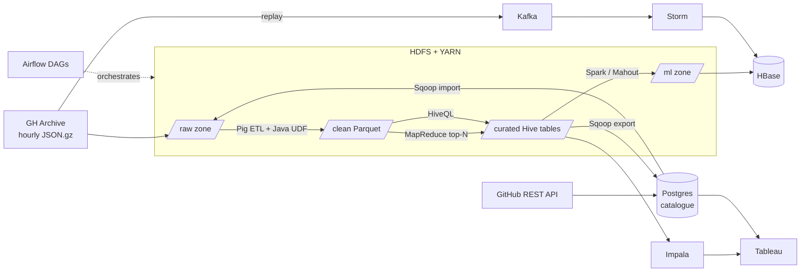
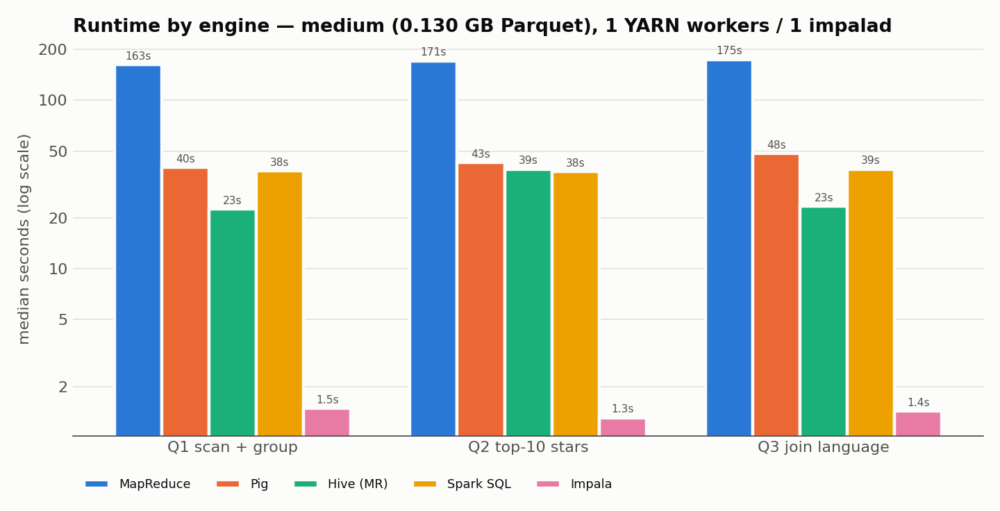
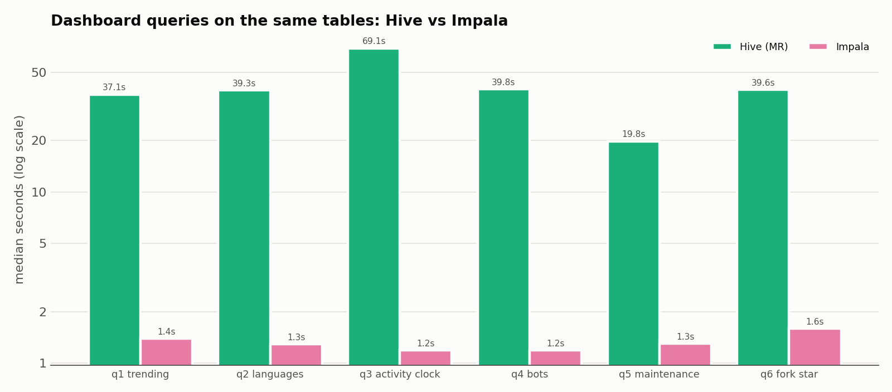

# GitHub Open Source Pulse

**End-to-end Big Data Analytics on public GitHub activity, using 12 Hadoop-ecosystem tools on a Dockerised multi-node cluster.**

The project ingests hourly event dumps from [GH Archive](https://www.gharchive.org/) together with repository metadata from the GitHub REST API. It answers ten analytical questions: trending repos, language trends, bot activity, maintainer health, repo recommendations, viral-repo prediction and live spike detection. Each tool in the Hadoop stack does a job it suits, and the results land in a Tableau dashboard.


---

## Highlights

- **2.4 million real GitHub events** pass through a batch and a streaming pipeline. A data-quality gate fails the run on any violation.
- **HDFS + YARN cluster** with 2 DataNodes (replication 2) and 2 NodeManagers, plus Hive, Impala, HBase, Kafka, Storm and Airflow. Everything runs in Docker Compose on one laptop.
- **Memory-aware "stages":** only the services the current step needs are running. The full stack runs on 16 GB, and a `LITE` mode covers 8 GB.
- **Engine benchmark:** the same 3 queries run on MapReduce, Pig, Hive, Spark SQL and Impala.
- **Recommendations:** Mahout item CF beats Spark ALS and a popularity baseline (Recall@10 = 0.251).
- **Real-time:** Kafka feeds Storm, which writes to HBase. A replayed GitHub hour (~167k events at 60× speed) runs with 0 failed tuples and raises z-score spike alerts.
- **Tests:** JUnit (Pig UDF, MapReduce via LocalJobRunner, Storm via LocalCluster), pytest for the Pig ETL, SQL data-quality assertions and a full end-to-end script.

## Architecture



## Analytical questions and tools

| # | Question | Tools |
|---|---|---|
| Q1 | Most active and fastest-rising repos per day/week | MapReduce (top-N), Hive, Sqoop export |
| Q2 | Language and topic trends | Sqoop catalogue + Hive join, Impala |
| Q3 | Activity by hour and weekday (UTC vs IST) | Hive, Impala |
| Q4 | Bot vs human share of activity | Pig (bot tagging during ETL), Hive |
| Q5 | Maintainer health: PR open→merge time, issue close ratio | Hive |
| Q6 | Fork/star ratio, solo vs community repos | Spark (Gini, top-contributor share) |
| Q7 | "Starred X also starred Y" recommendations | Mahout item CF → HBase; Spark ALS for comparison |
| Q8 | Will a new repo go viral? | Spark MLlib (GBT vs logistic regression) |
| Q9 | Live events/min, top-K repos, spike alerts | Kafka → Storm → HBase |
| Q10 | Repo activity clusters | Mahout k-means |

## Key results

Full write-up: [docs/results.md](docs/results.md). Measured on 15 hours of September 2025 data (2,397,993 events).

- **Bots** produce 28–32% of all events. They write 60% of commit comments, 52% of issue comments and 49% of pull requests.
- **Recommendations** (205 users, held-out latest 20% of stars):

  | Method | Hit rate | Recall@10 | Coverage |
  |---|---|---|---|
  | Mahout item CF (LLR) | **0.263** | **0.251** | **0.53** |
  | Spark ALS (implicit) | 0.259 | 0.237 | 0.24 |
  | Popularity baseline | 0.044 | 0.041 | 0.01 |

- **Viral prediction:** logistic regression reaches AUC-ROC 0.73, a 2.7× lift over the base rate.
- **Engine benchmark:** Impala answers in about 1.3 s, while the JVM/YARN engines (MapReduce, Pig, Hive, Spark SQL) take 20–170 s. At this scale start-up time dominates, and MapReduce also suffers from the small-files problem.

<p align="center">
  
  
</p>

## Quick start

Requirements: Docker Desktop (16 GB recommended; 8 GB works with `LITE=1`), about 30 GB of free disk and a GitHub personal access token with public read access.

```bash
./setup.sh                                  # checks Docker, creates .env, downloads + verifies tarballs, builds images
# put your GitHub token in .env (GITHUB_TOKEN=...) for catalogue seeding
make stage STAGE=batch                      # 16 GB laptop; on an 8 GB machine prefix LITE=1
make download MODE=sample                   # 3 hours of 2025-09-01 into HDFS (demo = 2 days, large = 8 days)
```

**Windows:** run everything from Git Bash with Docker Desktop (WSL 2 backend). The scripts handle Git Bash path
conversion and `.gitattributes` keeps LF line endings. `make` is not installed by default; every target is a
one-liner, so type the command directly:

```bash
./setup.sh
scripts/stage.sh batch                                        # make stage STAGE=batch
docker compose exec -T edge scripts/download_gharchive.sh --mode sample   # make download
MSYS_NO_PATHCONV=1 docker compose exec -T edge pulse ddl      # make pulse ARGS="ddl" (any step)
scripts/mvn.sh -q package ; scripts/topology.sh ; scripts/e2e.sh
```

`MSYS_NO_PATHCONV=1` matters only when an argument looks like an absolute path; the scripts set it themselves.

The whole batch pipeline for one day runs with either:

- `docker compose exec airflow airflow dags test gh_pulse_daily 2025-09-01` after `make stage STAGE=orchestrate`, or
- the individual steps below, which are exactly what the DAG tasks run.

```bash
make stage STAGE=warehouse
make pulse ARGS="ddl"                       # Hive DDL (raw JSON, clean, curated, ML tables)
make pulse ARGS="catalogue-init"            # Postgres catalogue schema + event-type lookup
make pulse ARGS="seed-catalogue 500"        # GitHub API -> Postgres (rate-limited, cached)
make pulse ARGS="sqoop-import-lookups"      # Sqoop: known_bots, event_types -> Hive
make pulse ARGS="sqoop-import-repos"        # Sqoop: incremental repo catalogue -> HDFS
make pulse ARGS="pig-etl 2025-09-01"        # Pig + Java UDF: raw JSON -> clean Parquet
make pulse ARGS="dq clean 2025-09-01"       # data-quality gate
make pulse ARGS="mr-top 2025-09-01"         # MapReduce: daily top-N repos per event type
make pulse ARGS="hive-curated 2025-09-01"   # Hive curated tables
make pulse ARGS="dq curated 2025-09-01"
make pulse ARGS="hive-window"               # window tables (trending window, repo health)
make pulse ARGS="sqoop-export"              # Sqoop: curated results -> Postgres
```

Then ML and serving (stage `ml`, then `serving`), Impala (stage `impala`) and streaming (stage `streaming`):

```bash
make pulse ARGS="spark-features"  ;  make pulse ARGS="spark-viral"
make pulse ARGS="recs-prep" ; make pulse ARGS="mahout-itemcf" ; make pulse ARGS="recs-eval" ; make pulse ARGS="mahout-kmeans 6"
make pulse ARGS="hbase-prep" ; make stage STAGE=serving ; make pulse ARGS="hbase-init" ; make pulse ARGS="hbase-load"
scripts/hlookup.sh similar JetBrains/koog
make stage STAGE=streaming ; make pulse ARGS="kafka-topics" ; make topology ; make replay DT=2025-09-01 H=12-12 SPEED=60
# make topology = clean restart (offsets reset to latest). The optional live feed has its own topic:
#   docker compose exec edge python3 streaming/live_poller.py   +   scripts/topology.sh gh.events.live
```

## Stages (memory budgets)

Only one stage runs at a time. `scripts/stage.sh <stage>` starts what that stage needs and stops everything else.

| Stage | Services | Used for |
|---|---|---|
| `core` | Postgres, NameNode, 2 DataNodes, ResourceManager, 2 NodeManagers, JobHistory | HDFS/YARN demos |
| `batch` | core + edge | download, Pig, MapReduce, Sqoop |
| `warehouse` | core + Hive metastore + HiveServer2 + edge | Hive, Sqoop hive-import/export, benchmarks |
| `ml` | core + Hive metastore + edge | Spark, Mahout |
| `serving` | core + ZooKeeper + HBase + edge | HBase loads and lookups |
| `impala` | HDFS + metastores + Impala (YARN stopped) | Impala queries |
| `streaming` | HDFS + ZooKeeper + HBase + Kafka + Storm (YARN stopped) | live topology |
| `orchestrate` | core + Airflow (Airflow switches stages per task) | DAG runs |

## Web UIs

| UI | URL |
|---|---|
| NameNode | http://localhost:9870 |
| YARN ResourceManager | http://localhost:8088 |
| MapReduce JobHistory | http://localhost:19888 |
| HiveServer2 | http://localhost:10002 |
| Impala | http://localhost:25000 |
| HBase Master | http://localhost:16010 |
| Storm UI | http://localhost:8081 |
| Airflow | http://localhost:8082 |

## Tests

```bash
scripts/mvn.sh package                                   # JUnit: Pig UDF, MapReduce (LocalJobRunner), Storm (LocalCluster)
docker compose exec edge pytest -q tests/python          # Pig ETL in local mode on real-event fixtures
make pulse ARGS="dq clean 2025-09-01"                    # data-quality assertions (fail the task on violation)
```

End to end (both DAGs, streaming, assertions): `LITE=1 make e2e` on an 8 GB machine. `E2E_FROM=3` resumes at the checks.

## Project structure

```
airflow/dags/     gh_pulse_daily + gh_pulse_models DAGs
bin/pulse         single CLI entry point for every pipeline step
docker/           Dockerfiles, Hadoop/Impala configs, Postgres init
pig/              ETL script (raw JSON -> clean Parquet) + benchmark queries
java/             Maven: Pig UDF + MapReduce jobs (hadoop-jobs), Storm topology (storm-topology)
hive/             DDL, curated/window tables, analytics Q1–Q6, benchmark queries
impala/           Impala setup
spark/            feature engineering, viral model, ALS, rec evaluation, HBase/k-means prep
mahout/           item-based CF and k-means jobs
hbase/            table definitions + bulk loader
sqoop/            Postgres <-> HDFS/Hive imports and exports
streaming/        Kafka replay producer + live GitHub API poller
dq/               data-quality SQL gates
bench/            engine benchmark runner, results and charts
tableau/          extract exporter + dashboard guide
tests/            pytest + fixtures (JUnit lives under java/)
docs/             results, demo script, screenshots
```

## Documentation

- [PLAN.md](PLAN.md): full system design, decisions and risks
- [docs/results.md](docs/results.md): findings and benchmark analysis
- [docs/demo_script.md](docs/demo_script.md): viva/demo walkthrough
- [tableau/README.md](tableau/README.md): dashboard setup
- `docs/screenshots/`: cluster UIs (NameNode, YARN, Storm, HBase, Impala)

## Data source

Event data comes from [GH Archive](https://www.gharchive.org/) (September 2025, before GitHub trimmed event payloads in October 2025). Repository metadata comes from the [GitHub REST API](https://docs.github.com/en/rest).
